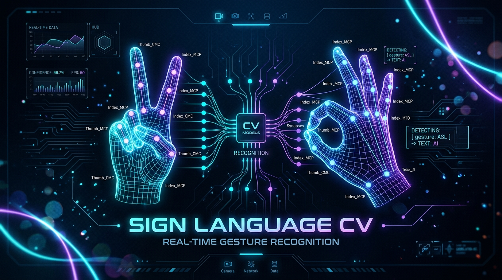
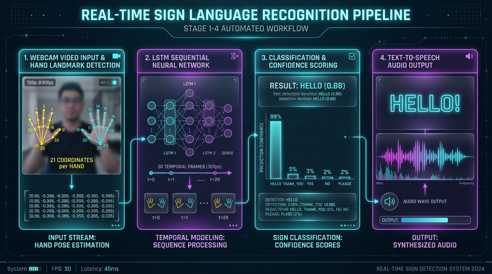

<div align="center">



# Sign Language CV

### Real-Time Computer Vision & Deep Learning Sign Language Translator with Text-to-Speech

<p align="center">
  
  
  
  
  
  
</p>

<p align="center">
  An end-to-end, high-performance sign language recognition pipeline capable of tracking two hands, modeling temporal gesture dynamics across sequential frames with a deep LSTM network, and vocalizing detected phrases in real-time through an offline speech synthesis engine.
</p>

</div>

---

##  Overview

**Sign Language CV** bridges the communication barrier between sign language users and non-signers. Unlike traditional image classification models that evaluate static single-frame gestures, this project captures the **temporal motion trajectory** of hand movements across a rolling window of 30 frames. 

By leveraging Google's **MediaPipe Hand Landmarker** vision pipeline, the system extracts 21 precise 3D landmark coordinates per hand (up to 2 hands = 126 coordinate values per frame). These temporal sequences are fed into a recurrent **Long Short-Term Memory (LSTM)** neural network to infer signs with high confidence before audibly announcing them with **pyttsx3**.

---

##  Key Highlights

- ** Dual-Hand 3D Landmark Tracking:** Tracks up to 42 individual hand landmarks in real-time at 30+ FPS using modern MediaPipe Tasks Vision (`hand_landmarker.task`).
- ** Temporal Sequence Modeling:** Deep 2-layer LSTM architecture with recurrent dropout layers capable of distinguishing dynamic multi-frame gestures from static hand poses.
- ** Instant Speech Feedback:** Integrated offline Text-to-Speech (TTS) engine that speaks phrases as soon as gesture prediction confidence exceeds the threshold (85%+).
- ** Custom Dataset Pipeline:** Includes built-in interactive dataset collection utilities with automatic on-screen countdowns and NumPy `.npy` sequential matrix storage.
- ** Lightweight & Edge-Ready:** Runs entirely on CPU with zero cloud latency or subscription requirements.

---

##  System Architecture & Pipeline

<div align="center">
  
</div>

The real-time recognition pipeline operates in four orchestrated stages:

1. **Vision Ingestion & Landmark Extraction:**
   - Captures webcam stream at 720p / 30 FPS via OpenCV.
   - Converts frames to RGB and feeds them into `mp.tasks.vision.HandLandmarker`.
   - Normalizes and flattens $(x, y, z)$ coordinates for 2 hands (zero-padded when one hand is obscured):
     $$\text{Keypoints} \in \mathbb{R}^{2 \times 21 \times 3} = \mathbb{R}^{126}$$

2. **Rolling Window Sequence Buffer:**
   - Collects keypoint vectors into a rolling FIFO queue of $T = 30$ frames:
     $$\text{Input Tensor} \in \mathbb{R}^{1 \times 30 \times 126}$$

3. **LSTM Classification & Confidence Filtering:**
   - Evaluates the rolling sequence using the trained LSTM model.
   - Extracts probability distributions via Softmax:
     $$\hat{y} = \text{argmax}(\text{Softmax}(Z)), \quad \text{Condition: } P(\hat{y}) \ge 0.85$$

4. **Speech Synthesis Engine:**
   - Dispatches debounced label notifications to `pyttsx3` to articulate words aloud without stuttering or infinite loops.

---

##  Supported Gestures

| Sign | Category | Action Type | Vocabulary Target |
| :--- | :--- | :--- | :--- |
| **Hello** | Greeting | Wave / Open Palm Forward | `hello` |
| **Thank You** | Courtesy | Hand to Chin Forward Extension | `thank_you` |
| **Yes** | Affirmation | Fist Nodding Downward | `yes` |
| **No** | Negation | Index & Middle to Thumb Pinch | `no` |
| **Please** | Politeness | Open Hand Circular Chest Motion | `please` |

*Easily expandable to additional ASL words, numbers, or phrases by adding labels to `collect_data.py`.*

---

##  Model Architecture

```
Model: "sequential"
_________________________________________________________________
 Layer (type)                Output Shape              Param #   
=================================================================
 lstm (LSTM)                 (None, 30, 64)            48,896    
 dropout (Dropout)           (None, 30, 64)            0         
 lstm_1 (LSTM)               (None, 128)               98,816    
 dropout_1 (Dropout)         (None, 128)               0         
 dense (Dense)               (None, 64)                8,256     
 dense_1 (Dense)             (None, 5)                 325       
=================================================================
 Total params: 156,293 (610.52 KB)
 Trainable params: 156,293 (610.52 KB)
 Optimizer: Adam | Loss: Categorical Crossentropy | Metric: Accuracy
```

---

##  Repository Structure

```
Sign-language-cv/
├── assets/
│   ├── icons/                  # Vector SVG icons for documentation
│   │   ├── brain.svg
│   │   ├── camera.svg
│   │   ├── hand.svg
│   │   └── ...
│   └── images/                 # Architecture infographics & banners
│       ├── banner.png
│       └── pipeline_architecture.png
├── data/                       # Recorded gesture coordinate sequences
│   ├── hello/                  # 30 sequence matrices (30 x 126 .npy)
│   ├── no/
│   ├── please/
│   ├── thank_you/
│   └── yes/
├── collect_data.py             # Interactive gesture recorder
├── hand_tracking.py            # Diagnostic script for MediaPipe landmarks
├── real_time_predict.py        # Live webcam translator with TTS vocalization
├── test_webcam.py              # Hardware webcam connectivity test
├── train_model.py              # Keras LSTM neural network training pipeline
├── hand_landmarker.task        # MediaPipe landmark model bundle
├── sign_model.h5               # Trained LSTM model weights
├── requirements.txt            # Python dependencies
└── README.md                   # Project documentation
```

---

##  Quickstart Guide

### 1. Clone the Repository
```bash
git clone https://github.com/Taniiie/Sign-language-cv.git
cd Sign-language-cv
```

### 2. Create and Activate Virtual Environment
```bash
# Windows
python -m venv venv
venv\Scripts\activate

# macOS / Linux
python3 -m venv venv
source venv/bin/activate
```

### 3. Install Dependencies
```bash
pip install -r requirements.txt
```

### 4. Verify Camera & Hand Landmark Tracking
Run the baseline tracking script to ensure your webcam and MediaPipe model bundle are working properly:
```bash
python hand_tracking.py
```
*Press `q` on the video window to exit.*

---

##  Workflow & Usage

### Step 1: Collect Custom Sign Sequences
To record your own hand gestures:
1. Open `collect_data.py` and specify the gesture label in `SIGNS = ['your_gesture']`.
2. Run the collection script:
```bash
python collect_data.py
```
3. The interface will provide a 1.5-second countdown window before each sequence so you can prepare your hand position. Sequences are saved as `.npy` matrices in the `data/` directory.

### Step 2: Train the LSTM Model
Train the deep neural network on the captured temporal sequences:
```bash
python train_model.py
```
This loads all `.npy` windows, performs train-test splitting (85/15), fits the LSTM network over 100 epochs, and serializes the resulting model to `sign_model.h5`.

### Step 3: Run Real-Time Translation & TTS
Execute live sign language inference:
```bash
python real_time_predict.py
```
- Green landmark nodes will trace finger joints and knuckles in real-time.
- When an identified sign crosses the confidence threshold (85%), the predicted label and score appear on screen, and your computer will speak the sign aloud.

---

##  Configuration Parameters

You can adjust hyperparameters in `real_time_predict.py`:

| Parameter | Default | Description |
| :--- | :--- | :--- |
| `SEQUENCE_LENGTH` | `30` | Number of consecutive frames captured for each gesture decision window. |
| `CONFIDENCE_THRESHOLD` | `0.85` | Minimum classification probability required before triggering speech. |
| `num_hands` | `2` | Maximum hands detected simultaneously by MediaPipe. |
| `speech_rate` | `150` | Word articulation speed (words per minute) configured in `pyttsx3`. |

---

##  License

This project is licensed under the [MIT License](LICENSE).

---

<div align="center">
  <sub>Developed by <a href="https://github.com/Taniiie">Taniiie</a> with MediaPipe, TensorFlow, and OpenCV.</sub>
</div>
